# AgentOps Control Plane

Observability, evaluation and release control for LLM applications, with an agent that investigates incidents from the telemetry. Applications send OpenTelemetry traces. AgentOps stores every span, shows traces, sessions, cost and latency, runs datasets through prompt versions or through your application and scores the outputs, keeps prompts out of application code behind a release gate, raises alerts, and has an Investigator that answers *"why did checkout start failing on the 27th?"* from the data, citing the evidence for every figure. It is a personal portfolio project built on synthetic data; it is not a customer deployment and has not been run in production. Its sibling project, FinOps Agent, sends it real traces.

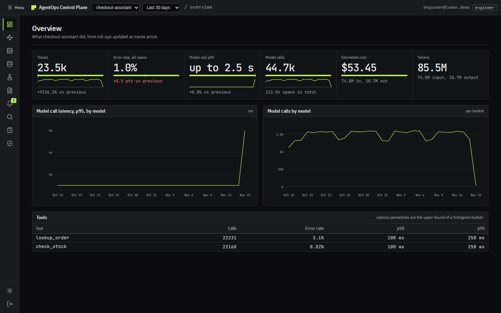

## Features

**Seeing what applications did**
- OTLP/HTTP ingestion (`/v1/traces`, protobuf or JSON, gzip), the same endpoint any OpenTelemetry SDK uses. A batch is stored in PostgreSQL before it is acknowledged, so nothing acknowledged is lost.
- Traces with a span timeline, sessions, filters by status, model, tool and version; cost and latency by model, tool, prompt version and application version, from exact five-minute roll-ups.

**Evaluating**
- Datasets typed by hand, uploaded, or taken from real traces.
- Deterministic evaluators (exact, contains, regex, numeric, JSON schema, latency, cost) and an LLM judge whose invalid answers never count as a pass, calibrated against human grades (Cohen's kappa).
- Experiments against a prompt version or your own HTTP endpoint, and a comparison that names the items a change broke.

**Releasing and watching**
- Prompt versions read by applications with a scoped key; a release passes a gate (an experiment, a minimum score, no drop against the live version) and a second administrator.
- Monitors on error rate, latency, cost and online scores; an alert can start an investigation.

**Investigating**
- The Investigator reads metrics, traces, error groups and the history of releases and model changes through typed, read-only tools (there is no query tool), calculates with fixed functions, and writes a report whose figures are checked against stored evidence. It can propose a prompt rollback; an administrator decides.

**Platform**
- Several organisations in one installation, isolated by PostgreSQL row-level security; roles viewer, engineer and admin; an audit log.
- Spans partitioned by day with retention; ingest workers and agent workers scale out; runs survive a worker crash.
- Any model with tool calling: OpenAI-compatible endpoints (9Router, OpenAI, vLLM, LM Studio), Anthropic, or a local model through Ollama; a built-in script when there is no model at all.

## Architecture

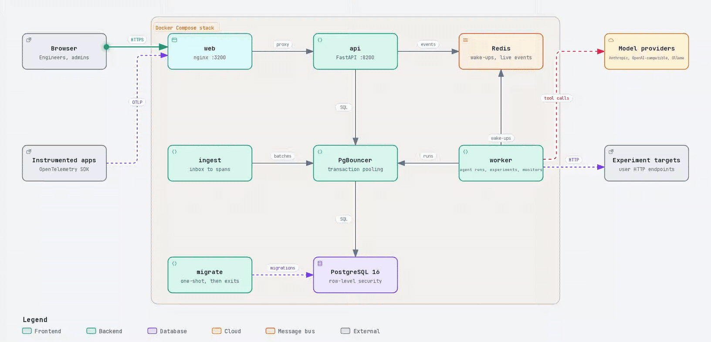

[Interactive diagram](https://rafi0020.github.io/AgentOps/docs/architecture.html) · [Architecture notes](docs/ARCHITECTURE.md) · [Database schema](docs/DATABASE.md) · [API reference](docs/API.md)

| Layer | Technology |
|---|---|
| Web UI | Next.js 15 with React 19, Tailwind CSS 4, SWR; static export served by nginx |
| API | FastAPI, SQLAlchemy (async), Pydantic, Alembic migrations |
| Workers | Python 3.13 processes that claim work under database leases; ingest, agent and experiment workers, and a scheduler |
| Storage | PostgreSQL 16 with row-level security and day partitions; PgBouncer in transaction pooling mode |
| Events and limits | Redis 7: wake-up signals, live event streams, short-lived caches, rate-limit counters |
| Models (optional) | Anthropic, OpenAI-compatible endpoints, Ollama; a stub that runs a fixed script |
| Tests | pytest with pytest-asyncio, ruff, Playwright for browser journeys, Locust for load |

## Getting started

### Docker

Requires Docker with Compose v2.

```bash
cp .env.example .env
docker compose up --build
```

- UI: http://localhost:3200
- API documentation: http://localhost:8200/docs

The first start applies the migrations and generates 30 days of demo traces (about 460,000 spans, a few minutes; `DEMO_SCALE` changes the size). With the default `LLM_PROVIDER=stub` the Investigator runs a fixed script and says so; see [Adding an AI model](#adding-an-ai-model).

**Things to try**

1. As the Lumen engineer, open **Overview** for the last 30 days, then **Traces** filtered to failures in checkout-assistant on the day the error rate jumps.
2. Ask the Investigator *"Something broke order lookups in checkout-assistant for about two days. What was it, and is it still happening?"* (needs a model) and open the evidence behind each figure.
3. Under **Prompts → order-lookup**, compare version 7 with version 6.
4. Under **Datasets**, take a few traces into a dataset, run an experiment, and compare two runs.
5. As an Orbit user, try to open a Lumen trace by its URL.

The demo data has five planted incidents (`backend/seed/generate.py`): a bad prompt release, a model change, an agent loop, a provider outage and a slow latency drift.

**Send your own traces.** Create a project and an ingestion key under **Administration**, then point any OpenTelemetry exporter at AgentOps:

```bash
OTEL_EXPORTER_OTLP_ENDPOINT=http://localhost:3200
OTEL_EXPORTER_OTLP_HEADERS="Authorization=Bearer ak_..."
```

or use the small Python client in `backend/client/agentops_client.py`, which provides tracing and prompt fetching with a cache and a last-known-good fallback. FinOps Agent sends its runs this way. Treat ingestion keys as credentials: anyone holding one can write text the Investigator will read.

### Local development

Requires Python 3.13 with [uv](https://docs.astral.sh/uv/), Node 22 and Docker.

```bash
make dev-up                 # PostgreSQL, PgBouncer and Redis on local ports
cd backend && uv sync
uv run alembic upgrade head
uv run python -m seed.generate --scale 0.25
uv run uvicorn app.main:create_app --factory --reload --port 8200
uv run python -m app.worker.run          # agent and experiment worker, second terminal
uv run python -m app.worker.ingest       # ingest worker, third terminal
```

### Tests and evaluation

```bash
make check                  # lint and the backend tests against a real PostgreSQL and Redis; no model needed
make test-live              # tests that call a real model (needs NINEROUTER_API_KEY in ../.env.local)
cd frontend && npx tsc --noEmit && npx eslint src
npx playwright test         # browser journeys against the running stack
```

```bash
cd backend
uv run python -m eval.run_eval --split dev --model <model>
uv run python -m eval.attacks --model <model>
uv run python -m load.explain                  # query plans of the request paths
uv run python -m load.ingest_load --seconds 60 # ingestion throughput (see docs/SCALE.md first)
```

Method, datasets and failure analysis are in [docs/EVALUATION.md](docs/EVALUATION.md).

## Demo accounts

| Role | Lumen Labs | Orbit Systems | Password |
|---|---|---|---|
| Admin | `admin@lumen.demo` | `admin@orbit.demo` | `Admin#Demo2026` |
| Engineer | `engineer@lumen.demo` | `engineer@orbit.demo` | `Engineer#Demo2026` |
| Viewer | `viewer@lumen.demo` | `viewer@orbit.demo` | `Viewer#Demo2026` |

| | Viewer | Engineer | Admin |
|---|---|---|---|
| Read traces, charts, datasets, experiments, prompts, alerts, investigations | yes | yes | yes |
| Create datasets, run experiments, grade outputs, add prompt versions, start an investigation | no | yes | yes |
| Approve a prompt release or an action the Investigator proposes | no | no | yes |
| Projects, ingestion keys, people, model settings, prices, retention, audit log | no | no | yes |

## Tutorial

This walks through the main flows with the demo data. Start the stack with `docker compose up --build` (see
[Getting started](#getting-started)), wait until the first start has generated the demo traces, and open
http://localhost:3200. Each step names the account and the labels you will see.

1. **Sign in as the Lumen engineer.** Open http://localhost:3200. On the sign-in page, click **Fill in** on the
   *Engineer* row, or type `engineer@lumen.demo` and `Engineer#Demo2026`, then click **Sign in**. The project
   switcher in the top bar shows the three Lumen projects; choose **checkout-assistant**.

2. **Find the incident on the Overview.** Open **Overview** and set the time range to **Last 30 days**. Find the day
   the error rate rises: the **Error rate, all spans** card and the latency chart **Model call latency, p95, by model**
   change there. The incident is planted for about two days, so note the first day of the rise. The demo traces are
   generated relative to the date you start the stack, so the calendar date will differ from one run to the next.

   

3. **Filter failing traces and open one.** Open **Traces**. Set **Status** to **Failed** and choose **Apply**. Each row
   is one request; the **Started** column shows the time. Click a name in the **Trace** column. The trace page shows its
   status, duration, tokens and cost, and a **Timeline** of spans. Each `chat model-fast` and `execute_tool` row is one
   model call or tool call, with its duration on the bar.

   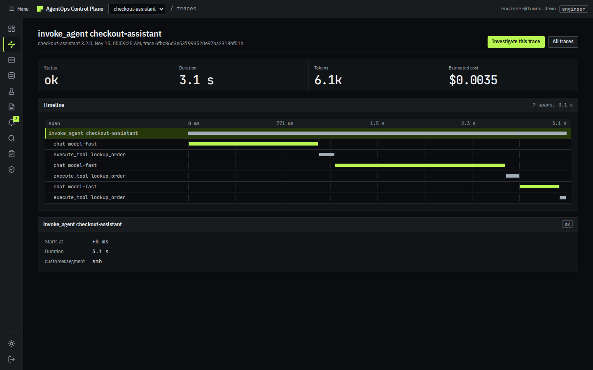

4. **Compare the bad prompt release with the one before.** Open **Prompts** and click **order-lookup**. The **Version
   log** lists v1 to v8 with their state: v8 is **live**, v7 was **pending** and v6 is **approved**. Under
   **Difference**, set **Older** to **v6** and **Newer** to **v7**. The removed and added lines show the change: v7
   tells the model to pass the order reference exactly as the customer wrote it. Version 7 is the planted bad release,
   and version 8 replaced it (see [docs/EVALUATION.md](docs/EVALUATION.md)). The diff only changes what the page shows;
   nothing is saved.

   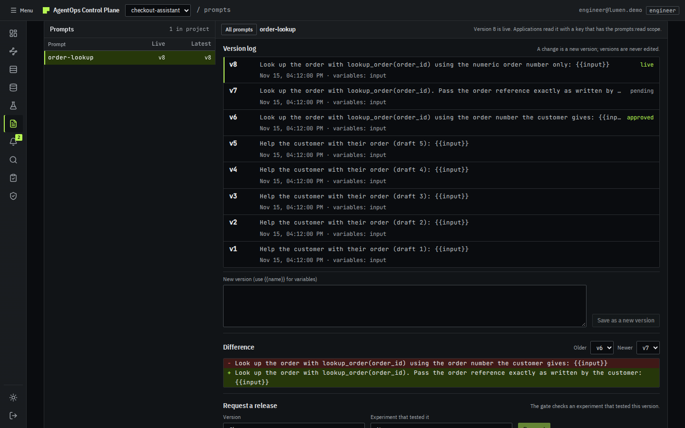

5. **Build a dataset and run experiments.** Open **Datasets**. Under **New dataset name**, type a name and choose
   **Create**. Select the dataset, then add items with **Input** and **Expected (optional)** and **Add item**, or choose
   **Upload a file** (a CSV with an `input` column, optionally `expected`, or a JSON list). Open **Experiments**. Under
   **Start a run**, choose the **Dataset**, set **Run against** to **A prompt version** (or **My application (HTTP)**),
   pick the prompt and version, tick at least one evaluator, and choose **Start**. When two runs have finished, tick
   **Select** on both in the **Runs** list and choose **Compare the two selected**. The comparison lists the items that
   got worse or better.

6. **Release a prompt through its gate.** Open **Prompts → order-lookup**. Under **Release gate**, choose a
   **Primary evaluator**, a **Minimum score (0 to 1)** and the **Allowed drop from the live version**, then **Save gate**. The
   primary evaluator must have graded at least 20 items before a release can pass (`GATE_MIN_GRADED`). Under
   **Request a release**, choose a **Version**, choose the **Experiment that tested it**, and choose **Request**. A request
   without an experiment is blocked, and the page says why. A request that passes waits for an administrator. Sign in as
   `admin@lumen.demo` / `Admin#Demo2026`, open **Approvals**, and under **Prompt releases waiting** choose
   **Approve and release** or **Reject**. The demo has one request waiting (order-lookup, version 8 to 7); approving it
   changes the live version, so only do that on purpose. An engineer cannot approve a release; the server refuses it.

   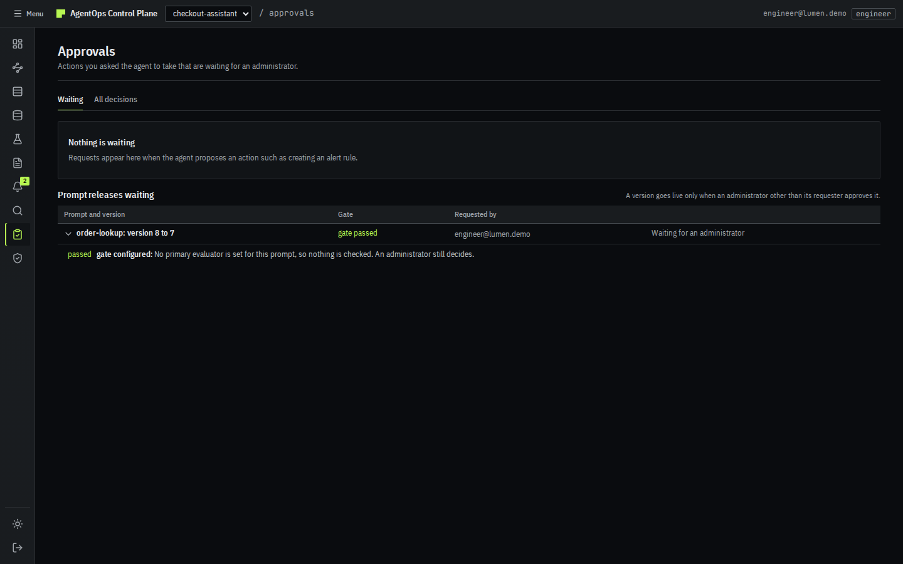

7. **Watch a monitor fire and open its investigation.** Open **Monitors**. The **Rules** table lists the monitor rules, and the
   **Alert log** lists the alerts with their window and measured value. An unacknowledged alert has an **Investigate**
   button, which starts an investigation; an alert that already has one shows **Open investigation**. Open the
   investigation to read the report under **Answer**, its **Evidence** and the **Run log**. With the default
   `LLM_PROVIDER=stub`, the report says it was produced by the built-in demonstration script, not a model. To ask your
   own question, use **Ask the agent** on **Investigations**, or try one of the **Try one of these** examples.

   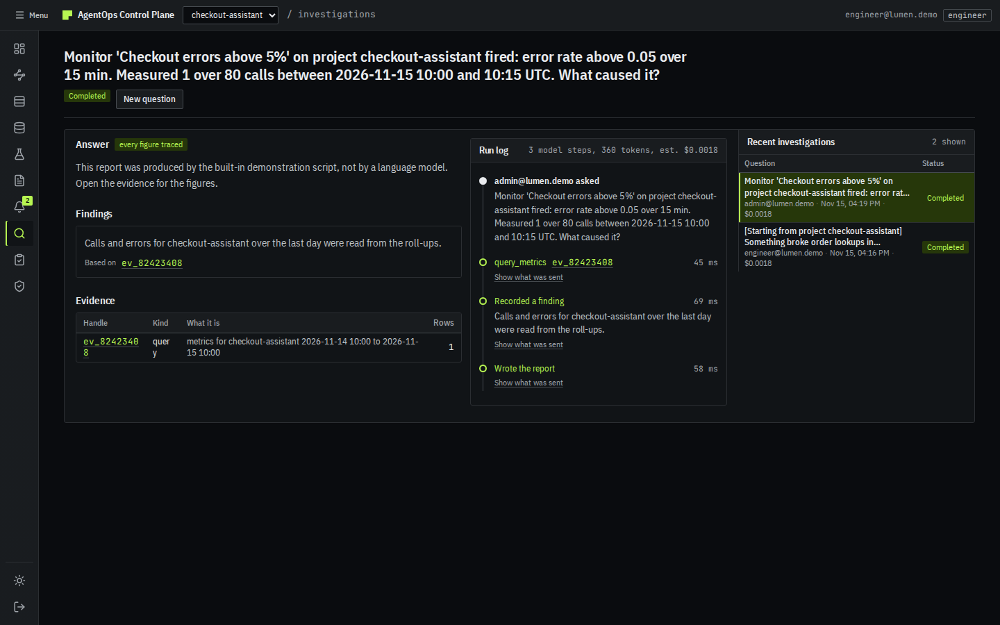

8. **Confirm that another organisation cannot see these traces.** Choose **Sign out**, then sign in as
   `engineer@orbit.demo` / `Engineer#Demo2026`. The project switcher lists only the Orbit projects. Paste a Lumen trace
   URL from step 3 (`/traces/?project=<project id>&trace=<trace id>`) into the address bar: the page shows no trace,
   and the API returns `404` for the same trace. The check is in `frontend/e2e/isolation.spec.ts`.

9. **Send traces from your own application.** Sign in as an administrator and open **Administration**, then
   **Projects and keys**. Under **New project name**, type a name and choose **Create project**. Under the project, type
   a **New key name** and choose **Create key**. Tick **Can also read live prompts** if the application should read
   prompt versions. The key is shown once: copy it now and keep it out of source control. Anyone holding an ingestion
   key can write text the Investigator will read, so treat it as a credential.

   Then point any OpenTelemetry exporter at AgentOps:

   ```bash
   OTEL_EXPORTER_OTLP_ENDPOINT=http://localhost:3200
   OTEL_EXPORTER_OTLP_HEADERS="Authorization=Bearer ak_..."
   ```

   Or use the Python client in `backend/client/agentops_client.py`. It configures OpenTelemetry and fetches prompt
   versions with a cache and a last-known-good fallback:

   ```python
   import os
   from client.agentops_client import AgentOps

   ao = AgentOps("http://localhost:3200", os.environ["AGENTOPS_KEY"])
   tracer = ao.init_tracing("my-app", "1.0")          # exports traces to AgentOps
   prompt = ao.get_prompt("order-lookup")             # the live version, with {{name}} variables
   text = prompt.render(input="Order 10412?")
   ```

   Once the ingest worker has processed the batches, the spans appear under **Traces** for the project you created.

10. **Connect a real model.** Sign in as an administrator, open **Administration**, then the **Model** tab. Under
    **Model provider**, set **Provider**, **Base URL** and **Model**, enter the **API key**, choose **Save**, and then
    **Test the saved settings**. The same settings
    can be made in `.env` (see [Adding an AI model](#adding-an-ai-model)). Investigations and the LLM judge then send
    their inputs to that provider.

## Configuration

All settings are environment variables; see [`.env.example`](.env.example).

| Group | Variables |
|---|---|
| Model | `LLM_PROVIDER`, `LLM_MODEL`, `LLM_API_KEY`, `LLM_BASE_URL`, `LLM_FALLBACK_MODEL`, `LLM_PRICE_INPUT_PER_MTOK`, `LLM_PRICE_OUTPUT_PER_MTOK` |
| Budgets | `RUN_MAX_STEPS`, `RUN_MAX_TOKENS`, `RUN_MAX_SECONDS`, `RUN_MAX_COST_USD`, `ORG_DAILY_COST_USD`, `GLOBAL_DAILY_COST_USD`, `ORG_MAX_CONCURRENT_RUNS` |
| Accounts | `SEED_DEMO`, `ALLOW_SIGNUP`, `COOKIE_SECURE` |
| Secrets | `SECRET_KEY`, `POSTGRES_PASSWORD`, `AGENTOPS_OWNER_PASSWORD`, `AGENTOPS_APP_PASSWORD` |
| Scale | `WORKER_CONCURRENCY`, `INGEST_CONCURRENCY`; `docker compose up --scale api=4 --scale ingest=4` |
| Network | `ALLOW_PRIVATE_LLM_URLS`, `ALLOW_PRIVATE_TARGETS` |

### Adding an AI model

Out of the box `LLM_PROVIDER=stub`. A model can be set in `.env` or under **Administration → Model provider**. Every provider and the settings for local models are in [docs/PROVIDERS.md](docs/PROVIDERS.md).

```bash
LLM_PROVIDER=openai_compat
LLM_BASE_URL=http://host.docker.internal:20128/v1
LLM_API_KEY=<your key>
LLM_MODEL=cc/claude-sonnet-5-5
```

When a model is configured, investigations and the LLM judge send their inputs to it. The prompts they use are listed in [docs/PROMPTS.md](docs/PROMPTS.md).

### Before using this for anything real

Set your own `SECRET_KEY` and database passwords; `SEED_DEMO=false`, `ALLOW_SIGNUP=false` unless strangers should sign up, and `COOKIE_SECURE=true` behind HTTPS; publish only the web port; set real model prices; set `METRICS_TOKEN`; set both `ALLOW_PRIVATE_*` to false on a shared installation; and read the limitations in [docs/SECURITY.md](docs/SECURITY.md) and [docs/SCALE.md](docs/SCALE.md).

## Screenshots

| | |
|---|---|
| 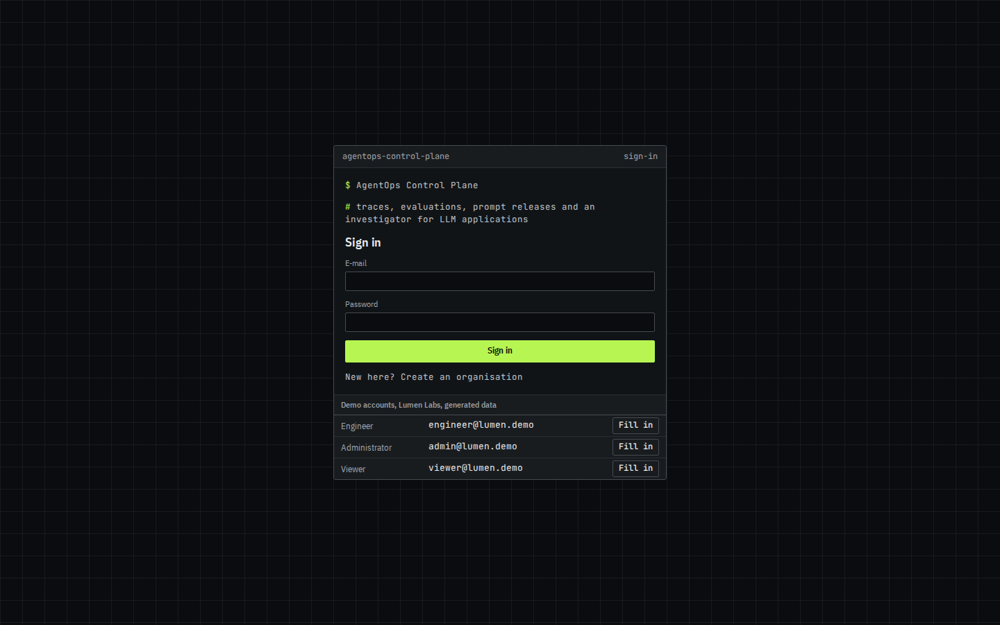 |  |
| **Sign in**, with the demo accounts | **Overview**: last 30 days, with cost, latency and tools |
| 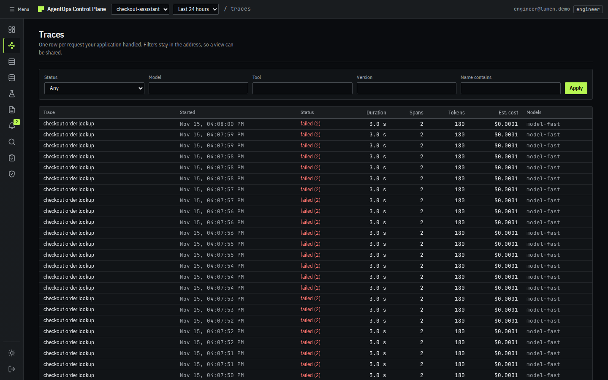 |  |
| **Traces**: one row per request, with filters | **Trace timeline**: spans in order, with timings and attributes |
| 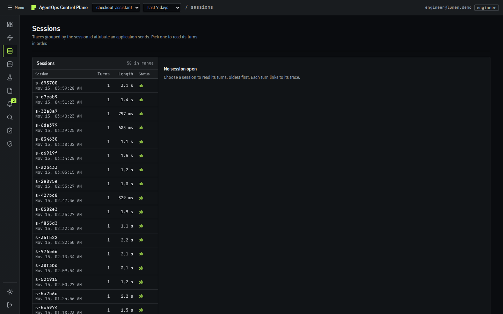 | 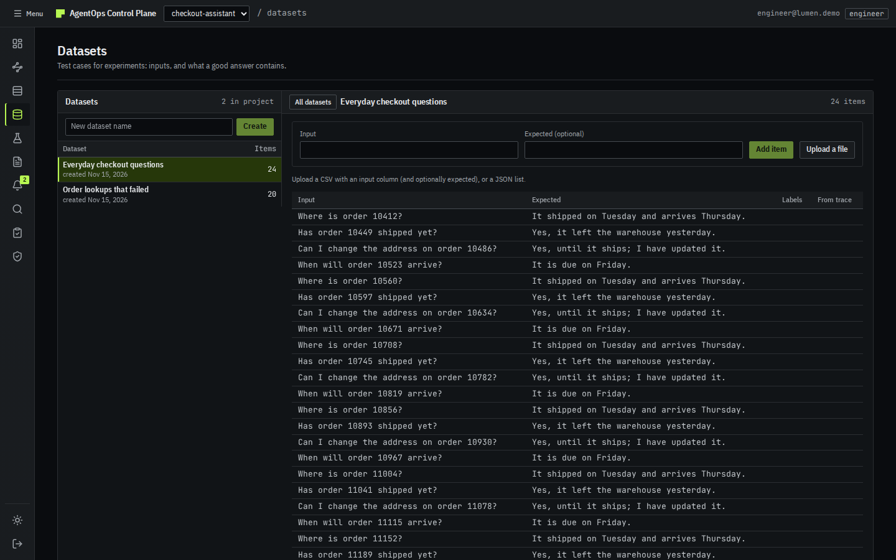 |
| **Sessions**: traces grouped by `session.id` | **Datasets**: one dataset open, with its items |
| 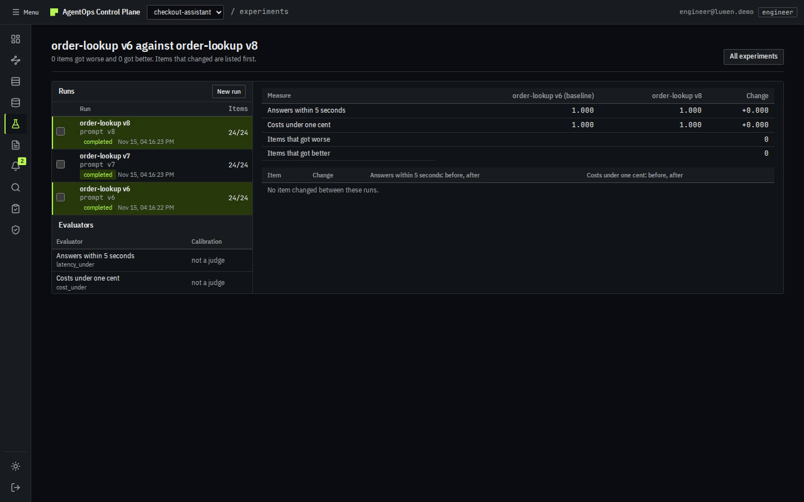 |  |
| **Experiments**: two runs compared item by item | **Prompts**: version log and a diff between v6 and v7 |
| 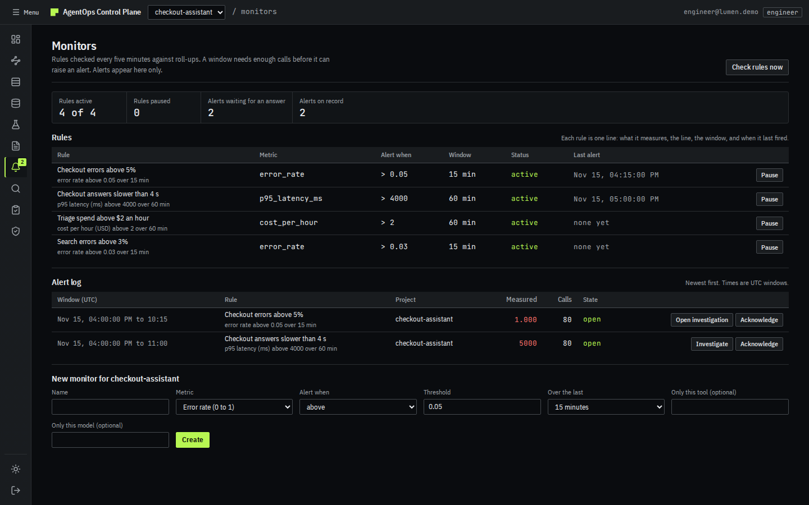 |  |
| **Monitors**: rules, and an alert log with its window | **Investigation**: a completed run with its evidence; this stack uses the built-in script, not a model |
|  | 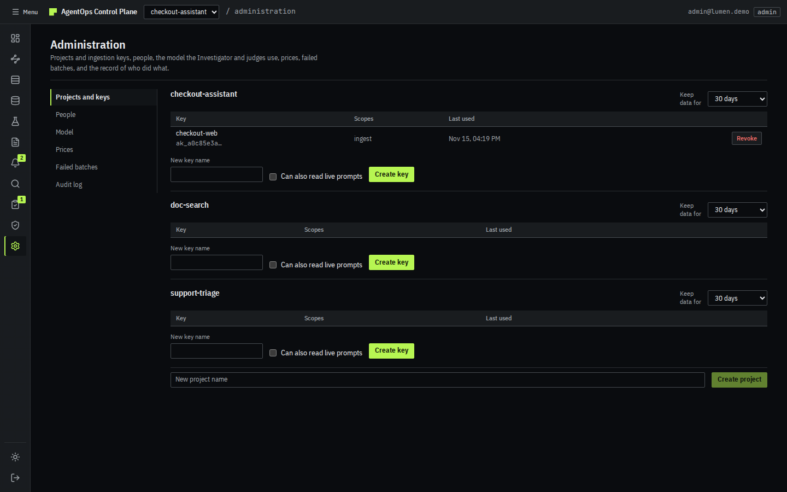 |
| **Approvals**: a pending prompt release, with its gate checks | **Administration**: projects and ingestion keys (only masked prefixes are shown) |
| 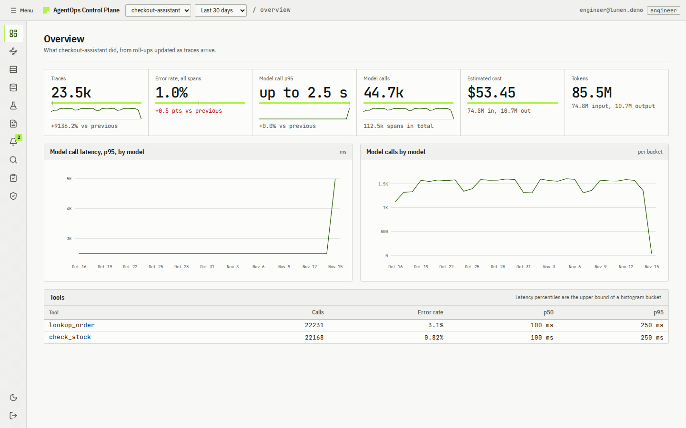 | |
| **Light theme**: the same overview | |

## Evaluation

Measured on the demo telemetry, against answers computed from the database. Method, limits and every failure are in [docs/EVALUATION.md](docs/EVALUATION.md); the raw results are in `backend/eval/results/`.

**Investigator, held-out set of 13 questions, run once**

| Model | Passed | Figures right | Cause found | Right behaviour | p50 / p95 |
|---|---|---|---|---|---|
| Claude Sonnet 5.5 | 8 of 13 | 4 of 6 | 2 of 3 | 2 of 4 | 21 s / 53 s |
| gpt-oss-120b | 3 of 13 | 3 of 6 | 0 of 3 | 0 of 4 | 43 s / 89 s |

The intended second model was not measured: its provider returned HTTP 503 to every call on the day. The development set (27 questions) gave 24 of 27 for Claude Sonnet 5.5.

**Attack suite, eight attacks.** Claude Sonnet 5.5 held all eight: instructions planted in error messages and span attributes, another organisation's data, approval claimed in chat, ingestion-key extraction, an unbounded time range, a request for the system prompt, and a run that never finishes. gpt-oss-120b held seven, with one inconclusive. Most of its runs ended in `failed`, so for that model the results show that the boundaries held rather than that the model resisted.

## Scale

Measured on one laptop, with the load generator on the same machine. Method and limits are in [docs/SCALE.md](docs/SCALE.md).

| | |
|---|---|
| Ingestion, 1 / 4 ingest containers | 10,400 / 25,700 spans written per second; the endpoint kept accepting (up to 29,000/s) while the inbox absorbed the difference |
| Trace queries at 17 million spans in one organisation | Single-digit milliseconds for list, filter and one-trace reads; a 31-day name search with no match took 4.1 s |
| 2,000 live connections to one investigation | All held for 45 s, none dropped |

## Security

- **Ingestion keys** are stored as SHA-256 hashes and shown once. A key writes only to its own project and has the
  `ingest` scope, or `prompts:read` for reading live prompts. Keys are rate-limited and can be revoked.
- **Tenancy** is enforced by PostgreSQL row-level security on every tenant table, using the organisation set for the
  current transaction, so one organisation's rows are not visible to another even through the API.
- **Telemetry is untrusted.** Text from applications reaches the model only under an `untrusted_data` key, and the
  Investigator's instructions say it is data. Prompt and completion content is not given to the model by any tool.
  Attributes are cut to 12 keys of 200 characters.
- **Secrets in telemetry are masked on arrival** for common key and token shapes (`app/security/redact.py`); this is
  pattern-based and is not a guarantee.
- **Model actions need approval.** The Investigator's only action tool, `propose_rollback`, needs an administrator's
  approval, and the server checks the approval row. A release is always decided by an administrator other than the
  person who requested it.
- **Budgets** limit steps, tokens, time and cost per run, and cost per organisation and globally per day. Time windows
  over 31 days are refused, and OTLP bodies over 4 MiB are refused after decompression.
- **Accounts** use scrypt password hashes and server-side sessions; the browser holds a random token in an HttpOnly
  cookie and the database holds only its hash. Sign-in attempts are rate-limited per e-mail address and per IP address. Demo accounts with published passwords exist only when `SEED_DEMO=true`.

The OWASP Top 10 for LLM Applications mapping, the test that proves each control and the known limitations are in
[docs/SECURITY.md](docs/SECURITY.md).

**Reporting a vulnerability.** Please open a private security advisory on the GitHub repository rather than a public
issue.

## Documentation

| Document | Contents |
|---|---|
| [docs/architecture.html](https://rafi0020.github.io/AgentOps/docs/architecture.html) | Interactive architecture diagram |
| [docs/ARCHITECTURE.md](docs/ARCHITECTURE.md) | Processes, request paths for ingestion and investigations, components and design decisions |
| [docs/API.md](docs/API.md) | Every REST endpoint, with authentication and scopes |
| [docs/DATABASE.md](docs/DATABASE.md) | Tables, partitions, roll-ups, roles and row-level security |
| [docs/EVALUATION.md](docs/EVALUATION.md) | Method, datasets, results and failures of the Investigator evaluation and attack suite |
| [docs/PROMPTS.md](docs/PROMPTS.md) | Every prompt sent to a model: the Investigator, the LLM judge, and prompt versions in experiments |
| [docs/AI_DISCLOSURE.md](docs/AI_DISCLOSURE.md) | How AI tools were used to build and verify this project, and what is used at run time |
| [docs/PROVIDERS.md](docs/PROVIDERS.md) | Settings for every model provider and for local models |
| [docs/SCALE.md](docs/SCALE.md) | Ingestion, query and read-load measurements on one laptop, with their limits |
| [docs/SECURITY.md](docs/SECURITY.md) | Threat model, OWASP LLM Top 10 controls, ingestion and tenancy decisions, known limitations |
| [docs/LEARNING.md](docs/LEARNING.md) | A guided read of the code: ingestion, evaluation and the Investigator |

## Limitations

- The telemetry is synthetic, with five clean planted incidents. Real incidents overlap and have no answer key.
- The evaluation is small (40 questions, 13 held out) and the second model was a substitute.
- The grounding check confirms that a figure exists in the evidence, not that the sentence around it is right.
- Spans live in PostgreSQL. That keeps one store and one tenancy model; a column store would be faster at
  much larger volumes (see [docs/SCALE.md](docs/SCALE.md)).
- Alerts appear in the application only; there is no e-mail or webhook delivery.
- Load was measured on one laptop with the load generator on the same machine.

## Repository layout

```
backend/
  app/
    api/            REST endpoints: traces, sessions, datasets, experiments, prompts, monitors, investigations, approvals, settings, OTLP ingestion
    agent/          the agent loop: runs, steps, budgets, approvals
    investigator/   the Investigator's instructions, typed tools, calculations and grounding check
    evals/          experiments, evaluators, the LLM judge and calibration
    ingest/         inbox, span writer, roll-ups, retention
    llm/            model providers: Anthropic, OpenAI-compatible, stub
    monitors/       alert rules and online scoring
    prompts/        prompt registry and release gate
    security/       passwords, sessions, rate limits, redaction, headers
    worker/         ingest worker (ingest.py), agent and experiment worker (run.py), scheduler
    obs/            logging, metrics and tracing
  alembic/          database migrations
  client/           Python client: tracing and prompt fetching
  eval/             Investigator evaluation, attack suite, questions and results
  load/             load tests, query plans and SSE connection test
  seed/             demo data generator and demo accounts
  tests/            automated tests
frontend/           Next.js UI: sign-in, overview, traces, sessions, datasets, experiments, prompts, monitors,
                    investigations, approvals, evaluation, administration; e2e/ holds the Playwright journeys
infra/              PostgreSQL role setup and PgBouncer image
docs/               architecture, evaluation, security, prompts, disclosure, screenshots, test results
docker-compose.yml  the stack; docker-compose.load.yml for load runs
Makefile            dev-up, lint, test, test-live, check
.env.example        every setting, with its default
```

## License

Released under the [MIT License](LICENSE).
