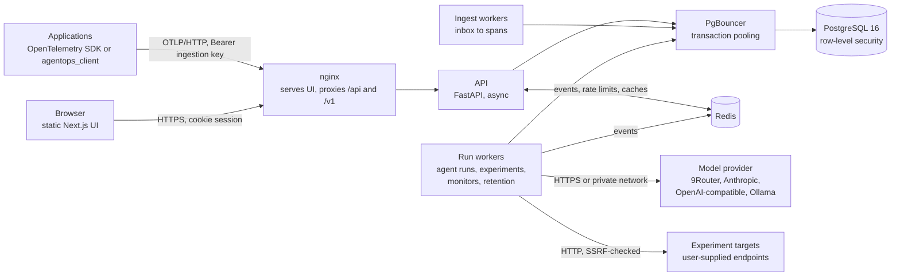
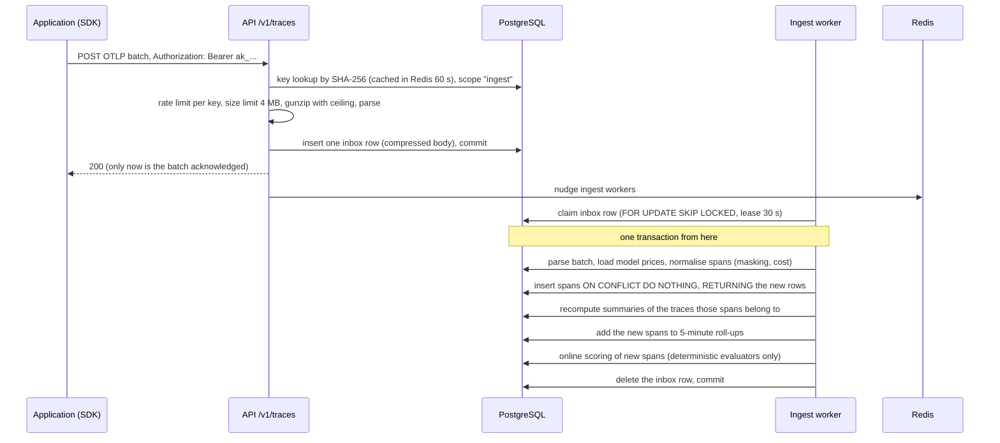

# Architecture

[Interactive diagram](architecture.html) (open the file in a browser)

## Overview



Five kinds of container run the application: `web` (nginx), `api`, `worker`, `ingest` and the data services
`db` with `pgbouncer`, and `redis`. A sixth, `migrate`, runs once at start-up to apply migrations and load the
demo data, then exits. The `worker` and `ingest` services run the same backend image with different commands.

## Processes

| Service | Command | What it does | Published port (host) |
|---|---|---|---|
| `web` | nginx | Serves the static UI; proxies `/api/` and `/v1/` to `api` | 3200 |
| `api` | `uvicorn app.main:create_app` | Sessions, the UI's API, OTLP receiver (`/v1/traces`), live prompts (`/v1/prompts/{name}`), `/metrics` | 127.0.0.1:8200 |
| `worker` | `python -m app.worker.run --concurrency N` | Claims and advances agent runs, runs experiments, runs the scheduler (monitors every 5 minutes, retention hourly) | none |
| `ingest` | `python -m app.worker.ingest --concurrency N` | Moves received batches from the inbox into spans, trace summaries and roll-ups | none |
| `migrate` | `python -m app.bootstrap` | Applies Alembic migrations as `agentops_owner`; loads demo accounts and data when `SEED_DEMO=true`; exits | none |
| `db` | `postgres:16-alpine` | Creates the two roles and the `agentops` and `agentops_test` databases (`infra/postgres/init.sh`) | 127.0.0.1:55442 |
| `pgbouncer` | transaction pooling | Pool in front of PostgreSQL: `pool_mode = transaction`, default pool size 40 | 127.0.0.1:56442 |
| `redis` | `redis:7-alpine` | Wake-up signals, live event streams, short-lived caches, rate-limit counters | 127.0.0.1:56389 |

`api` and `worker` can be scaled with `docker compose up --scale worker=4`; `ingest` with `--scale ingest=4`.
Processes coordinate only through PostgreSQL. The API trusts `X-Forwarded-For` because it sits behind nginx, so
its port is published on 127.0.0.1 only. The web port follows `WEB_BIND` (127.0.0.1 by default) and is also published
on the Docker bridge gateway (`WEB_INGEST_BIND`, default 172.17.0.1), so containers of other projects can send traces
to `host.docker.internal:3200`; neither address is reachable from the network.

## Request path: ingesting a trace batch



Steps in the order they happen:

1. The API checks the ingestion key and its `ingest` scope, applies the per-key limit (600 requests a minute by
   default) and refuses bodies over 4 MB, before and after decompression. It parses the body to reject invalid
   payloads early (400) and to count spans; a batch may hold at most 10,000 spans.
2. A non-empty batch is written to `ingest_batches` as one row, payload compressed with zlib. Only after that
   commit is the sender told `200`. If the write fails the sender gets `503` with `Retry-After: 5` and its
   exporter retries.
3. An ingest worker claims the row with `FOR UPDATE SKIP LOCKED`, sets a 30-second lease and increments
   `attempts`. Rows whose lease has expired are claimable again.
4. The worker does everything else in one transaction, so a crash at any point leaves the batch exactly as it
   was. Spans are inserted in a single statement with `jsonb_populate_recordset` and `ON CONFLICT DO NOTHING`;
   `RETURNING` gives exactly the rows that were new. Roll-ups, online scores and the inbox delete use only those
   new rows.

## Request path: asking the Investigator a question

```mermaid
sequenceDiagram
    participant U as Engineer (browser)
    participant A as API
    participant D as PostgreSQL
    participant R as Redis
    participant W as Run worker
    participant M as Model
    U->>A: POST /api/investigations {question}
    A->>D: insert run (status queued), audit entry
    A->>R: append run.status event, nudge workers
    A-->>U: 202 {id}
    U->>A: GET /api/investigations/{id}/events (Server-Sent Events)
    W->>D: claim run (lease 30 s, per-organisation limit)
    loop until finished, waiting or over budget
        W->>D: load run and steps; decide next action from the steps alone
        W->>M: messages rebuilt from steps, plus the tools this role may use
        M-->>W: tool call(s) or prose
        W->>D: commit the model step (counters on the run)
        W->>D: commit the tool step as started (its intent)
        W->>W: validate arguments; check role; check approval
        W->>D: run the tool (read-only queries, calculations)
        W->>D: commit outcome, evidence and any database effect in one transaction
        W->>R: append event
        R-->>A: event
        A-->>U: event
    end
    W->>D: status completed (report), or waiting_approval, waiting_user, failed, cancelled, budget_exceeded
```

1. `POST /api/investigations` (engineer or admin) checks a per-user rate (10 new runs a minute) and an
   organisation limit: queued plus running runs may not exceed 20 (`ORG_MAX_CONCURRENT_RUNS` 5 plus
   `ORG_MAX_QUEUED_RUNS` 15). It returns `202` with the run id.
2. A run worker claims the oldest claimable run. A run is claimable when it is queued, or running with an
   expired lease, and its organisation has fewer than 5 runs executing. The claim takes a transaction-level
   advisory lock so that the per-organisation limit is exact.
3. While the worker advances the run, a background task renews the lease every 10 seconds. If the lease is
   lost, the worker stops work on that run without recording anything more.
4. Each iteration of `advance()` does exactly one action: call the model, start a tool, or resolve a tool call
   that a crash or an approval left unfinished. Budgets are checked before every model call.
5. A tool that needs approval is recorded as `awaiting_approval`, its `approvals` row is created, and the run
   is parked. No worker holds it. An administrator's decision requeues the run; the worker then either runs the
   action once or tells the model it was rejected.
6. Every committed step is published to the run's Redis stream. The browser reads it over Server-Sent Events;
   a reconnecting browser sends `Last-Event-ID` and receives what it missed.
7. The run ends as `completed` (with its report), `failed`, `cancelled`, or `budget_exceeded`, keeping the
   evidence gathered so far.

## Other paths

- **Experiments.** A run worker also claims queued experiments (`app/evals/runner.py`). It works through the
  dataset items with a concurrency of 4, records each item's result in its own transaction, and skips items that
  already have a result. The claim lease is 120 seconds, renewed as each item is recorded.
- **Monitors.** Every 5 minutes, on the five-minute grid, the worker evaluates each active rule over the most recent
  complete fixed window of roll-ups and raises at most one alert per rule and window (`app/monitors/rules.py`).
- **Retention.** Hourly, the worker drops whole day partitions that no project still needs and deletes older rows
  for projects with shorter retention (`app/ingest/retention.py`).
- **Live prompts.** Applications read the live version of a prompt from `GET /v1/prompts/{name}` with a key that has
  the `prompts:read` scope. Results carry an ETag and a 30-second cache header.

## Components

| Component | Responsibility | Files |
|---|---|---|
| Agent runtime | The loop, generic over any tool set: decide the next action from stored steps, run it, commit, publish | `app/agent/runtime.py`, `context.py`, `budgets.py`, `events.py`, `tools.py` |
| Run worker | Claim runs under a lease, renew it, hand back on shutdown, abandon runs that keep failing; run experiments and the scheduler | `app/worker/run.py`, `scheduler.py`, `app/evals/runner.py` |
| Investigator | Its instructions, typed read-only tools, one approval-gated action, grounding of the report | `app/investigator/` (`agent.py`, `prompts.py`, `tools.py`, `common.py`, `compute.py`, `grounding.py`, `charts.py`) |
| Ingestion | Keys, OTLP parsing, the inbox, the span writer, roll-ups, dead batches | `app/api/ingest.py`, `app/ingest/`, `app/worker/ingest.py` |
| Evaluation | Datasets, deterministic evaluators, the LLM judge and its calibration, experiments and HTTP targets | `app/evals/`, `app/api/datasets.py`, `app/api/experiments.py` |
| Prompts | Immutable versions, labels, release requests, the release gate | `app/prompts/`, `app/api/prompts.py` |
| Monitors | Rules over roll-ups, alerts, online scoring | `app/monitors/`, `app/api/monitors.py` |
| LLM layer | One interface, adapters per provider, retry, fallback, concurrency cap, cost estimate | `app/llm/` |
| Persistence | Sessions, tenancy, transactions | `app/db.py`, `app/rls.py`, `app/models/` |
| Security | Passwords, sessions, CSRF, rate limits, encryption of provider keys, redaction | `app/security/` |
| Observability | JSON logs, Prometheus metrics, OpenTelemetry spans for the agent's own work | `app/obs/` |
| Client | Small Python client for applications: sends traces, reads live prompts | `client/agentops_client.py` |
| UI | Screens for traces, overview, datasets, experiments, prompts, monitors, investigations, approvals, administration | `frontend/` |

`app/agent/` imports nothing from `app/investigator/`. The Investigator is one `AgentSpec` (instructions plus a
tool registry) handed to the generic runtime.

## What Redis is and is not used for

| Use | Key or structure | If it is lost |
|---|---|---|
| Wake-up signal for workers | lists `ingest:wake`, `runs:wake` | Workers poll (every second), so work is delayed, not lost |
| Live events of a run | stream `run:<run id>`, at most 2,000 entries, 24 hours | The page reloads its state from the database |
| Ingestion-key cache | `ikey:<sha-256>`, 60 seconds | A database lookup; revoking a key deletes its entry at once |
| Session cache | session token hash, 60 seconds | A database lookup |
| Rate limits | sorted sets `rl:*`, sliding window | Limits restart; rate-limited routes return `503` while Redis is unreachable |
| Metric cache | `metrics:<org>:…`, 30 seconds | Figures are recomputed from roll-ups |

Redis is never the source of truth. Runs, steps, leases, the inbox, spans, roll-ups, approvals, experiments,
scheduled jobs and every decision are in PostgreSQL. If Redis were emptied, no batch or run would be lost.

## Design decisions

The reasons below are the rulings recorded in the build ledger (`.superpowers/sdd/2026-11-14-agentops/progress.md`)
and the design specification.

| Decision | Reason | Cost if wrong |
|---|---|---|
| Spans and roll-ups in PostgreSQL, partitioned by day, instead of a column store | One store and one tenancy model, enforced by row-level security as in FinOps. The size where this stops being enough is to be measured, not guessed (see SCALE.md) | Slower than a column store at tens of millions of spans |
| Batch written to the inbox before `200` | A success response must mean the data survives any restart | A slow database slows senders (they retry on `503`) |
| Parse, insert spans, trace summaries, roll-ups, online scores and inbox delete in one transaction | A crash at any point leaves the batch untouched, which is stronger than the plan's scenario | A large batch holds one transaction for its whole processing |
| Roll-ups updated incrementally from the spans a batch actually inserted | Rebuilding touched buckets per batch is quadratic at high ingest rates; incremental is linear in the batch and exact | A bug in the increment would drift silently; `test_rollups_equal_an_independent_count_of_the_spans` guards it |
| Trace-summary counts include a `roots` column in roll-ups | Trace counts can then come from roll-ups too | None known |
| Partitions created and dropped by `SECURITY DEFINER` functions owned by `agentops_owner`; the application role is revoked from each partition | The application role is not the table owner, so it cannot create or drop partitions, and it cannot read a partition around the parent table where row-level security applies | A grant on a partition would bypass row-level security; `test_partitions_cannot_be_read_around_the_parent_table` guards it |
| Spans written with one `jsonb_populate_recordset` statement, not a staging table | One round trip, and `RETURNING` gives exactly the new rows | None known |
| Run claim and experiment claim use leases, not a separate queue | A run, its steps and its claim live in one store; a dead worker's lease simply expires | Polling latency when Redis wake-ups are missed |
| Experiments run inside the run worker, with a per-experiment cost limit | Experiments are not in the `runs` table the daily cap reads; a per-experiment cap bounds each one | Many experiments in a day are bounded one by one, not in total |
| Human labels attach to an experiment result (item plus output hash), not to a bare item | A judge grades a specific output; the comparison must be on the same output | A label is not reused for a different output of the same item |
| Online scoring uses deterministic evaluators only | A judge would put a model call, its cost and its failures inside ingestion | Live scores cannot express qualities a rule cannot check |
| Online scores stored per span, unique per evaluator | A re-ingested batch adds nothing to score roll-ups | None known |
| The Investigator has no free-form SQL tool; it has typed, organisation-scoped tools | Questions are narrow enough for typed tools, which removes that attack surface | It can only answer what its tools can express |
| Figures in a report are checked against stored evidence; the model does no arithmetic | A figure with no source is either a mistake or invention | The check proves a number exists in the evidence, not that the sentence describes it correctly |
| A rollback is a release to a version that was live before; it needs no experiment | Returning to a known version is the fix for a bad release; a gate would delay it | The gate is only re-checked when an administrator approves |
| Applications read prompts at `/v1/prompts/{name}`, beside `/v1/traces`, with an ingestion-style key | Keeps key-authenticated routes apart from cookie-authenticated ones | Two authentication styles to explain |
| The Investigator's starting project or trace is written into the question text | The agent reads it there; no hidden run state | None known |
| Monitors may be created by engineers, not only administrators | Alerts are a working tool for the people who run applications | Alert rules can be changed by engineers |
| Demo data written through the same writer and roll-up functions as live traffic | The demo exercises the real path | The default demo is smaller than the two million spans in the specification (`DEMO_SCALE` 0.25) |

## Failure handling

| Failure | Behaviour |
|---|---|
| Inbox write fails | `503` with `Retry-After: 5`; the sender retries, nothing is acknowledged |
| Ingest worker killed mid-batch | Its transaction rolls back; the lease expires after 30 seconds; another worker processes the batch from the start |
| A batch keeps failing | Its error is stored; it is retried with growing delays, and after 5 attempts it is kept as `dead` for an administrator to replay or discard. A batch that kills its worker outright is counted too: once its attempts are used up it is marked `dead` rather than handed to another worker |
| Run worker killed mid-run | The lease expires; another worker claims the run and continues from its last committed step |
| Run worker killed mid-tool | A read tool runs again. A tool that is not idempotent is not repeated: the model is told the action was interrupted and may or may not have taken effect |
| Run crashes its workers repeatedly | A run may be picked up `RUN_MAX_ATTEMPTS` times (5). The next claim is refused and the run is failed as abandoned |
| Worker loses its lease while working | It stops without recording anything; the new holder continues |
| Model timeout, 429, 5xx or 529 | Retried up to 4 times with exponential back-off and jitter, honouring `Retry-After`; then the fallback model once; then the run fails with the provider's message |
| Model returns an invalid tool call | Returned to the model as an error; two in a row fail the run |
| Model answers in prose instead of calling a tool | Reminded once; a second time fails the run |
| Tool raises or times out (30 seconds by default) | Recorded; the model sees a safe message, never a stack trace |
| Run exceeds a budget | Ends as `budget_exceeded`; evidence so far is kept |
| Approval rejected | The model is told the action was rejected and why |
| Redis unavailable | Workers fall back to polling; rate-limited routes return `503`; events are lost from the live view only, and the page catches up from the database |
| Browser disconnects | The event stream resumes from `Last-Event-ID` on reconnect |
| Deploy (SIGTERM) | Workers stop claiming; unfinished runs are handed back at once (their attempt is returned) |

## What is not here

OpenTelemetry metrics and logs (only traces are ingested), e-mail or webhook delivery of alerts, single sign-on,
multi-factor authentication, streaming of partial model text to the browser, sub-agents, long-term memory across
runs, a free-form query tool for the Investigator, and Kubernetes manifests. A column-store back end is named as
the next step if measurements require it; the measurements are in SCALE.md.
